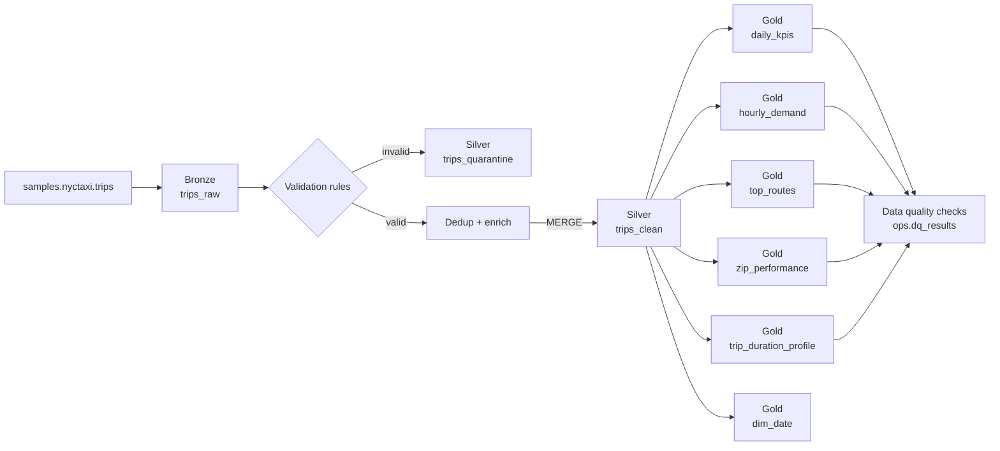

# NYC Taxi Lakehouse - Databricks Data Engineering Project

An end-to-end batch data pipeline on **Databricks** using the **medallion architecture** (Bronze → Silver → Gold) with **Delta Lake**. All transformation logic is written in **Spark SQL executed through PySpark (`spark.sql`)**.

## Architecture



## What this project demonstrates

| Skill | Where |
|---|---|
| Medallion architecture, Delta Lake, Unity Catalog schemas | all notebooks |
| Advanced Spark SQL: CTEs, CASE, window functions (LAG, RANK, DENSE_RANK, NTILE, running sums), percentiles | `02`, `03` |
| Data validation + quarantine pattern | `02` |
| Idempotent loading with deterministic keys and `MERGE INTO` | `02` |
| Data quality framework with logged results and fail-fast | `04` |
| Delta time travel, history, OPTIMIZE | `05` |
| Orchestration with Databricks Workflows | below |

## Repository structure

```
notebooks/
  00_setup.py               schemas + ops table
  01_bronze_ingestion.py    raw load + lineage columns
  02_silver_cleaning.py     validate, quarantine, dedup, enrich, MERGE
  03_gold_analytics.py      business tables (window functions)
  04_data_quality_checks.py SQL checks -> ops.dq_results
  05_delta_features.py      history, time travel, OPTIMIZE
  99_analysis_queries.sql   sample BI queries / dashboard
docs/
  resume_bullets.md
```

## How to run (Databricks Free Edition works)

1. Push this repo to GitHub.
2. In Databricks: **Workspace → Create → Git folder**, paste your repo URL. (Or import the notebooks manually.)
3. Run `00_setup` → `01` → `02` → `03` → `04` → `05` in order (serverless compute is fine).
4. If your catalog is not `workspace`, change the `catalog` widget value at the top of each notebook.

### Orchestrate with Workflows
Create a Job with 5 tasks chained in order: `00_setup → 01_bronze → 02_silver → 03_gold → 04_dq`. Add the `catalog` parameter and a daily schedule. Task 04 fails the run when a quality check fails.

## Sample insights (add your own screenshots to `docs/`)
- Peak demand hours per weekday
- ZIP codes generating 80% of revenue
- Day-over-day trip swings
- Trip duration percentiles by time of day

## Possible extensions
- Replace batch ingestion with Auto Loader / Structured Streaming
- Move to Lakeflow Declarative Pipelines (Delta Live Tables) with expectations
- Add a Databricks SQL dashboard on the gold tables
- Add CI with GitHub Actions
